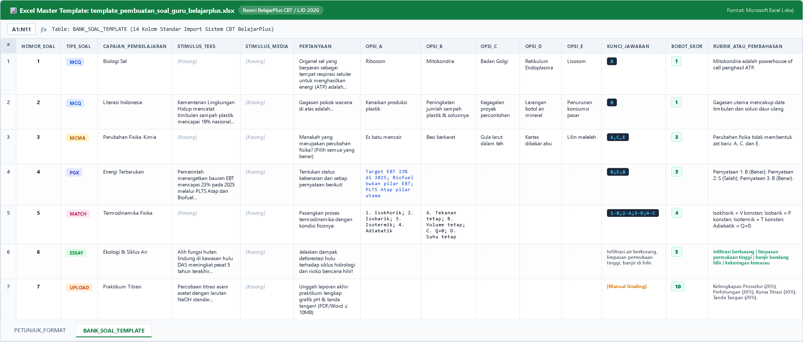
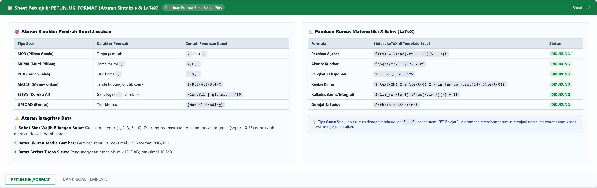

# 📝 Panduan Lengkap Template Pembuatan Soal Guru (BelajarPlus CBT & LJD)

Dokumen panduan resmi penyusunan instrumen evaluasi pembelajaran digital berbasis **Kurikulum Merdeka**, **Asesmen Kompetensi Minimum (AKM)**, dan **Lembar Jawab Digital (LJD)** untuk platform BelajarPlus.

---

## 📥 File Template Resmi Siap Pakai

Unduh berkas template master Excel:  
👉 **[`template_pembuatan_soal_guru_belajarplus.xlsx`](template_pembuatan_soal_guru_belajarplus.xlsx)**

---

## 📸 Tangkapan Layar Tampilan Template Excel Resmi

Berikut tampilan visual file Excel saat dibuka oleh guru:

### 1. Sheet `BANK_SOAL_TEMPLATE` (Format Tabel 14 Kolom & Contoh 6 Tipe Soal)

*(Gambar: Panel [template_soal_excel_preview.png](assets/template_soal_excel_preview.png) — Struktur kolom input soal, kode tipe respon, opsi, kunci, dan rubrik)*

### 2. Sheet `PETUNJUK_FORMAT` (Aturan Delimiter & Rumus Matematika LaTeX)

*(Gambar: Panel [template_soal_petunjuk_preview.png](assets/template_soal_petunjuk_preview.png) — Aturan karakter pemisah koma/titik-koma dan sintaks rumus LaTeX)*

---

## 1. Spesifikasi Teknis Kolom Template Excel

| No | Nama Kolom | Tipe Data | Keterangan & Aturan Pengisian | Status |
| :---: | :--- | :--- | :--- | :---: |
| 1 | `nomor_soal` | Integer | Nomor urut butir soal (`1`, `2`, `3`, dst). | **Wajib** |
| 2 | `tipe_soal` | Enum String | Pilih salah satu: `MCQ`, `MCMA`, `PGK`, `MATCH`, `ESSAY`, `UPLOAD`. | **Wajib** |
| 3 | `capaian_pembelajaran` | Text | Elemen Capaian Pembelajaran (CP) / materi pokok. | Opsional |
| 4 | `stimulus_teks` | Long Text | Narasi wacana, teks berita, kutipan literasi, atau tabel data. | Opsional |
| 5 | `stimulus_media` | File Name | Nama file gambar stimulus (contoh: `gambar_sel_1.png`). | Opsional |
| 6 | `pertanyaan` | Long Text | Butir kalimat pertanyaan atau instruksi tugas. | **Wajib** |
| 7 | `opsi_a` | Text | Pilihan A (atau deretan pernyataan untuk `PGK` / premis untuk `MATCH`). | Sesuai Tipe |
| 8 | `opsi_b` | Text | Pilihan B (atau deretan konsep pasangan untuk `MATCH`). | Sesuai Tipe |
| 9 | `opsi_c` | Text | Pilihan C (wajib untuk jenjang SMA 5 opsi). | Sesuai Tipe |
| 10 | `opsi_d` | Text | Pilihan D. | Sesuai Tipe |
| 11 | `opsi_e` | Text | Pilihan E. | Sesuai Tipe |
| 12 | `kunci_jawaban` | Delimited Text | Kunci jawaban sesuai format tipe soal. | **Wajib** |
| 13 | `bobot_skor` | Integer | Nilai poin maksimal (**Wajib bilangan bulat bulat**: `1`, `2`, `3`, `5`, `10`). | **Wajib** |
| 14 | `rubrik_atau_pembahasan` | Long Text | Kata kunci esai untuk AI (dipisah `\|`) atau pembahasan evaluasi guru. | **Wajib (Esai)** |

---

## 2. Bedah 6 Tipe Respon Soal & Format Kunci

### 1. Pilihan Ganda Tunggal (`MCQ`)
* **Karakteristik:** 1 opsi benar dari 4–5 pilihan. Auto-scoring instan 100% tanpa menggunakan kuota kredit AI.
* **Format Kunci:** Tulis 1 huruf kapital (`A` / `B` / `C` / `D` / `E`).
* **Contoh:**
  * `pertanyaan`: *Organel sel yang berperan sebagai tempat berlangsungnya respirasi seluler untuk menghasilkan energi (ATP) adalah...*
  * `opsi_a` - `opsi_e`: *Ribosom* | *Mitokondria* | *Badan Golgi* | *Retikulum Endoplasma* | *Lisosom*
  * `kunci_jawaban`: `B`
  * `bobot_skor`: `1`

### 2. Pilihan Ganda Kompleks (`MCMA`)
* **Karakteristik:** Model AKM di mana siswa dapat memilih lebih dari satu jawaban benar (kotak centang).
* **Format Kunci:** Huruf kapital dipisahkan tanda koma murni tanpa spasi (`A,C,E`).
* **Contoh:**
  * `pertanyaan`: *Manakah di antara peristiwa berikut yang merupakan perubahan fisika? (Pilih semua yang benar)*
  * `opsi_a`: *Es batu mencair di suhu ruang*
  * `opsi_b`: *Besi pagar rumah mengalami perkaratan*
  * `opsi_c`: *Pelarutan sendok gula ke dalam teh hangat*
  * `opsi_d`: *Kertas buku terbakar menjadi abu hitam*
  * `opsi_e`: *Lilin batang meleleh saat sumbu dinyalakan*
  * `kunci_jawaban`: `A,C,E`
  * `bobot_skor`: `3`

### 3. Kategori Benar / Salah Matriks (`PGK`)
* **Karakteristik:** Matriks pernyataan di mana siswa menentukan status kebenaran tiap baris.
* **Format Opsi:** Tulis seluruh pernyataan di kolom `opsi_a` dipisahkan tanda **titik koma (`;`)**.
* **Format Kunci:** Rangkaian status `B` (Benar) atau `S` (Salah) dipisahkan **titik koma (`;`)**, contoh: `B;S;B`.
* **Contoh:**
  * `stimulus_teks`: *Pemerintah menargetkan bauran Energi Baru Terbarukan (EBT) nasional mencapai 23% pada tahun 2025 melalui akselerasi PLTS Atap dan Biofuel.*
  * `opsi_a`: `Target bauran EBT 23% ditargetkan tahun 2025; Biofuel tidak termasuk pilar EBT; PLTS Atap merupakan tumpuan utama peningkatan EBT`
  * `kunci_jawaban`: `B;S;B`
  * `bobot_skor`: `3`

### 4. Menjodohkan / Matching Pair (`MATCH`)
* **Karakteristik:** Dua kelompok data berhadapan untuk dipasangkan siswa.
* **Format Opsi:**
  * `opsi_a` (Premis Kiri): Indeks angka (`1. ...; 2. ...; 3. ...`).
  * `opsi_b` (Konsep Kanan): Indeks huruf (`A. ...; B. ...; C. ...`).
* **Format Kunci:** Pasangan `Angka-Huruf` dipisahkan titik koma (contoh: `1-B;2-A;3-D;4-C`).
* **Contoh:**
  * `opsi_a`: `1. Isokhorik; 2. Isobarik; 3. Isotermik; 4. Adiabatik`
  * `opsi_b`: `A. Tekanan tetap; B. Volume tetap (W=0); C. Tanpa perpindahan kalor (Q=0); D. Suhu tetap (Delta U=0)`
  * `kunci_jawaban`: `1-B;2-A;3-D;4-C`
  * `bobot_skor`: `4`

### 5. Uraian Singkat / Esai Koreksi AI (`ESSAY`)
* **Karakteristik:** Uraian teks yang dikoreksi otomatis oleh modul semantik AI BelajarPlus berbasis rubrik kata kunci guru, dengan otoritas guru tetap memegang kendali penyesuaian nilai (*Human-in-the-Loop*).
* **Format Rubrik:** Tuliskan frasa kata kunci konsep penting pada kolom `rubrik_atau_pembahasan` dipisahkan garis tegak (`|`).
* **Contoh:**
  * `pertanyaan`: *Jelaskan dampak kerusakan vegetasi hutan di hulu DAS terhadap siklus hidrologi dan risiko bencana di hilir!*
  * `kunci_jawaban`: *Infiltrasi air berkurang sehingga limpasan permukaan meningkat drastis, memicu banjir bandang saat hujan dan kekeringan air sumur saat kemarau.*
  * `rubrik_atau_pembahasan`: `infiltrasi berkurang | penyerapan air tanah turun | limpasan permukaan tinggi | banjir bandang hilir | erosi tanah | kekeringan kemarau`
  * `bobot_skor`: `5`

### 6. Unggah Berkas Tugas / LKPD Praktikum (`UPLOAD`)
* **Karakteristik:** Siswa mengunggah berkas lembar kerja atau laporan praktikum (PDF, Word, JPG, Excel) dengan batas ukuran **maksimal 10 MB**.
* **Format Kunci:** Tuliskan `[Manual Grading oleh Guru]`.
* **Contoh:**
  * `pertanyaan`: *Unggah laporan akhir praktikum titrasi asam-basa lengkap dengan tabel volume, grafik kurva pH, dan foto lembar kerja bertanda tangan! (Format PDF/Word <= 10MB)*
  * `kunci_jawaban`: `[Manual Grading oleh Guru]`
  * `bobot_skor`: `10`

---

## 3. Notasi Rumus Matematika (LaTeX) & Media Stimulus

### Format Penulisan LaTeX
Sematkan kode LaTeX di dalam tanda dollar (`$...$`):

| Jenis Notasi | Contoh Kode LaTeX | Tampilan di Layar Siswa |
| :--- | :--- | :--- |
| **Pecahan** | `$f(x) = \frac{2x^2 + 5x}{x - 3}$` | Pecahan vertikal rapi |
| **Bentuk Akar** | `$\sqrt{x^2 + y^2} = r$` | Simbol akar proporsional |
| **Pangkat & Indeks** | `$E = m \cdot c^2$` atau `$x_{1,2}$` | Eksponen dan indeks |
| **Reaksi Kimia** | `$\text{2H}_2 + \text{O}_2 \rightarrow \text{2H}_2\text{O}$` | Persamaan reaksi kimia |
| **Kalkulus** | `$\lim_{x \to 0} \frac{\sin x}{x} = 1$` | Limit dan integral standar |

### Media Gambar Stimulus
* Format berkas: `.png` atau `.jpg`.
* Resolusi maksimal: `1920x1080` piksel, ukuran file $\le$ 2 MB.
* Letakkan narasi teks wacana di kolom `stimulus_teks` agar tersaji antarmuka *Split-Screen* (kiri wacana stimulus, kanan lembar pilihan respon).

---

## 4. Alur 8 Langkah Pengoperasian di Portal BelajarPlus

1. **Login & Masuk Pusat Kendali:** Akses `https://belajarplus.id/auth` lalu buka dashboard pengajar di `/admin`.
2. **Navigasi ke Menu Penugasan:** Buka sidebar **E-LEARNING** $\rightarrow$ **Penugasan** (`/admin/assignments`).
3. **Unggah Template Excel Soal:** Klik tombol **"Tambah Penugasan"** lalu upload file template Excel yang telah diisi.
4. **Konfigurasi Parameter Ujian:** Atur batas waktu pengerjaan (durasi menit), jendela jadwal akses, acak urutan soal (shuffle), dan proteksi anti-cheat (Focus Tracker FSM 3 Peringatan).
5. **Distribusi Kelas:** Centang rombel target (misal: *Kelas 10-A*, *Kelas 10-B*) lalu klik **"Simpan Penugasan"**.
6. **Uji Coba via "Pratinjau Asesmen":** Uji coba paket soal dari sudut pandang siswa tanpa meninggalkan riwayat nilai kotor (*Zero DB Dirty*).
7. **Pengerjaan Lembar Jawab Digital (LJD):** Siswa mengerjakan soal dengan ketahanan jaringan offline (*Write-Through LocalStorage*); jawaban tidak akan hilang saat Wi-Fi terputus mendadak.
8. **Evaluasi Hasil Siswa & Ekspor e-Rapor:** Buka menu **Hasil Siswa** (`/admin/submissions`), reviu koreksi otomatis esai AI (*Human-in-the-Loop*), dan klik **"Export Excel"** untuk transfer nilai ke rapor.

---

## 5. Troubleshooting & FAQ Guru

* **Tanya: Mengapa persentase kelulusan AKM berbeda dengan jumlah butir soal benar?**  
  *Jawab:* Pastikan kolom `bobot_skor` selalu menggunakan bilangan bulat integer (`1`, `2`, `3`, `5`, `10`), bukan angka pecahan ganjil (seperti 0.33) agar kalkulasi agregat sistem tidak mengalami deviasi pembulatan.
* **Tanya: Apakah nilai siswa yang sakit atau izin susulan akan merusak rata-rata kelas?**  
  *Jawab:* Tidak. BelajarPlus menerapkan pembedaan kritis `NULL` vs `0`. Siswa yang belum dinilai berstatus `NULL` dan otomatis dikecualikan dari pembagi rata-rata kelas.
* **Tanya: Apa yang terjadi jika internet siswa terputus di tengah ujian?**  
  *Jawab:* Sistem otomatis beralih ke *Offline Cache Mode*. Jawaban tersimpan di memori browser lokal, dan otomatis disinkronkan ke server sekolah seketika koneksi pulih.
