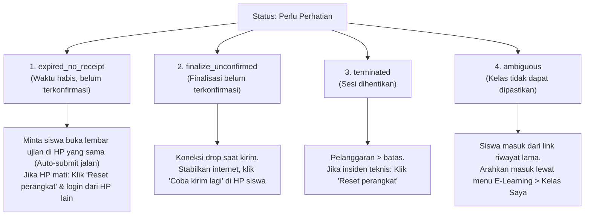

# PANDUAN TEKNIS & TROUBLESHOOTING ASAS BELAJARPLUS
**Dokumen Operasional Lapangan: Pengawas Ruangan, Proktor/Admin Sekolah, dan Trainer**  
*Berdasarkan Hasil Analisis Log Lapangan & Simulasi Serentak Jawa Tengah (16–21 November 2026)*

---

## ⚡ QUICK MATRIX: SOLUSI KILAT 1 MENIT DI RUANG UJIAN

| No | Gejala / Pesan Error | Penyebab Utama | Solusi Kilat Lapangan |
|:---|:---|:---|:---|
| **1** | **⛔ UJIAN TERKUNCI (Layar Merah + Sirine Alarm)** di HP Android | Keluar aplikasi, notifikasi WA/telepon, layar mati (*timeout*), floating window/Smart Sidebar. | Input password pengawas. Jika huruf pertama kapital otomatis, matikan Shift/Caps. |
| **2** | **"Password pengawas tidak cocok"** saat buka kunci layar merah | 1. Keyboard HP otomatis kapital huruf pertama (SHA-256 sensitif).<br>2. Password diubah guru saat ujian jalan (HP mencache password lama).<br>3. Terkunci dari sesi ujian sebelumnya. | 1. Cek tombol Caps/Shift pada keyboard HP.<br>2. Coba masukkan password lama sebelum diubah.<br>3. Masukkan password ujian pertama tempat HP terkunci.<br>4. **Jalur Pamungkas:** Pengaturan HP $\rightarrow$ Aplikasi $\rightarrow$ Belajar Plus Exam $\rightarrow$ **Paksa Berhenti (Force Stop)** $\rightarrow$ **Hapus Data (Clear Data)**. Buka lagi aplikasi (Fresh & tanpa alarm). |
| **3** | **Buka aplikasi BPE baru mau login langsung bunyi sirine** | Status terkunci dari ujian sesi sebelumnya tersimpan permanen di memori lokal (*SharedPreferences*) HP. | Lakukan **Clear Data** aplikasi Belajar Plus Exam dari Pengaturan HP siswa. |
| **4** | **Google Password Manager Autofill memicu alarm/kunci** | Pop-up sistem Android mengambil alih fokus layar $> 1.5$ detik. | Matikan autofill password di browser/HP, minta siswa ketik manual email & password. |
| **5** | **iOS: "Could not Start Assessment Mode..." (SEB)** | Sesi Apple AAC tersangkut akibat force-close sebelumnya, atau tombol *AssistiveTouch* (tombol melayang) aktif. | 1. Matikan *AssistiveTouch* di Pengaturan iOS $\rightarrow$ Aksesibilitas $\rightarrow$ Sentuh.<br>2. **Force Restart iPhone**: Tekan Vol Atas, Vol Bawah, tahan tombol Power sampai muncul logo Apple . |
| **6** | **iOS: "Wrong password!" saat tekan tombol daya [⏻] di SEB** | File config SEB mencache password saat pertama dibuka; keyboard iOS auto-kapital. | 1. Matikan tombol Shift (harus huruf kecil sesuai setting).<br>2. Gunakan password lama jika guru sempat mengganti password.<br>3. Jika buntu, lakukan **Force Restart iPhone**. |
| **7** | **Tampilan Hancur / FOUC (Logo Raksasa, Teks Polos, Tombol Abu-abu)** | Pakai browser bawaan HP (Vivo, Xiaomi, UC) dengan Ad-Blocker/Hemat Data aktif, atau jaringan drop saat memuat CSS. | 1. **Wajib pakai Google Chrome resmi** (bukan browser bawaan HP).<br>2. Matikan Ad-Blocker `[Ad ⃠]` di browser.<br>3. Tarik layar ke bawah untuk *Hard Refresh*. |
| **8** | **Kirim Jawaban Macet / Berputar di "Penyebab belum diketahui"** | Jaringan padat saat submit serentak, atau siswa mengunggah foto kamera berukuran besar (4-8 MB/foto). | 1. **DILARANG Logout / Hapus Data / Reset Sesi!** Jawaban 100% aman di IndexedDB HP.<br>2. Pindahkan HP ke area WiFi lancar atau tethering HP guru.<br>3. Tekan **"Coba kirim lagi"** satu kali.<br>4. Atau bawa HP ke ruang proktor, buka Beranda/Dashboard BelajarPlus (antrean akan *auto-flush* otomatis). |
| **9** | **Analitik: "Waktu habis, penerimaan belum terkonfirmasi" (`expired_no_receipt`)** | Waktu ujian habis saat HP mati, layar terkunci (iOS men-suspend JavaScript), atau sinyal drop di detik terakhir. | 1. Minta siswa buka kembali lembar ujian di HP yang sama dengan internet aktif $\rightarrow$ jawaban lokal langsung terkirim otomatis.<br>2. Jika HP mati/rusak: Proktor klik **"Reset perangkat"**, siswa lanjut kirim dari PC/HP lain. |
| **10** | **"Anda berada di luar area sekolah" / "Lokasi belum akurat"** | GPS belum aktif / akurasi rendah, izin lokasi browser belum diizinkan, atau radius geofencing sekolah terlalu sempit. | 1. Aktifkan GPS mode Akurasi Tinggi di HP.<br>2. Buka Google Maps sebentar agar titik biru stabil.<br>3. Admin sekolah perbesar radius geofencing (misal: 300m - 500m). |
| **11** | **Ujian Hari Ini Tidak Muncul di Analitik Pembelajaran** | Kelas di menu E-Learning statusnya Nonaktif (`is_active = false`). | Masuk menu **E-Learning $\rightarrow$ Kelas**, cari kelas terkait, klik tombol Power / Titik Tiga $\rightarrow$ **Aktifkan**. Refresh menu Analitik. |
| **12** | **Nilai / Aktivitas 0 di Tab Hasil Belajar** | Pengaturan Bobot & KKM semester belum ditentukan. | Klik tombol **"Buka"** pada kotak **Atur Bobot & KKM** di atas tabel nilai $\rightarrow$ centang aktivitas asesmen $\rightarrow$ tentukan bobot & KKM $\rightarrow$ Simpan. |
| **13** | **Siswa Tidak Melihat Kelas Baru di Akunnya** | Cache browser Chrome di HP siswa belum di-refresh. | Tarik layar ke bawah (*pull-to-refresh*) di halaman Kelas Saya, atau Relog (Keluar lalu Login lagi). |
| **14** | **Siswa HP Realme Buka AI / Tab Lain Tanpa Pelanggaran** | Menggunakan fitur bawaan *Floating Window / Mode Mengambang / Smart Sidebar*. | Pengawas ruangan wajib razia visual layar siswa: nonaktifkan *Smart Sidebar* dan fitur *Split Screen / Floating App* sebelum ujian. |

---

## 🛠️ PANDUAN DETAIL PER KATEGORI KENDALA

### KATEGORI 1: APLIKASI ANDROID (BELAJAR PLUS EXAM - BPE)

#### 1.1 Layar Merah Terkunci & Sirine Berbunyi
* **Penyebab Teknis:** BPE mengawasi status sematan layar (*screen pinning*) dan status fokus jendela aplikasi (`onWindowFocusChanged`). Alarm terpicu jika:
  1. Siswa keluar aplikasi atau menekan tombol navigasi / *gesture swipe*.
  2. Notifikasi masuk (pesan WA, panggilan suara/video, alarm jam, kalender).
  3. Layar mati otomatis (*screen timeout*) karena siswa membaca soal terlalu lama tanpa menyentuh layar.
  4. Muncul jendela mengambang (*Smart Sidebar*, *bubble chat*, *floating translation/AI*).
* **Solusi Pembukaan Kunci:**
  1. Pengawas memasukkan password pengawas pada kolom yang tersedia lalu klik **"Buka Kunci & Lanjut"**.
  2. **Perhatian Keyboard:** Periksa keyboard HP siswa. Keyboard bawaan sering mengaktifkan huruf kapital pada karakter pertama secara otomatis (misal terketik `Sman1gon` bukan `sman1gon`). Matikan tombol shift!
  3. **Jika Password Ditolak:** Jika guru sempat mengubah password di tengah ujian, gunakan **password lama** karena aplikasi mencache hash SHA-256 yang lama.
* **Solusi Darurat Jika Alarm Tidak Bisa Berhenti / Buntu:**
  1. Masuk ke **Pengaturan (Settings)** HP Android siswa.
  2. Masuk ke menu **Aplikasi (Manage Apps)** $\rightarrow$ pilih **Belajar Plus Exam**.
  3. Tekan tombol **Paksa Berhenti (Force Stop)** $\rightarrow$ sirine langsung mati seketika.
  4. Masuk ke sub-menu **Penyimpanan (Storage)** $\rightarrow$ tekan **Hapus Data (Clear Data / Clear Storage)**.
  5. Buka kembali aplikasi Belajar Plus Exam. Aplikasi langsung bersih (*fresh*), status terkunci lama hilang, dan siswa dapat masuk ujian dengan aman.

#### 1.2 Buka Aplikasi Mau Ujian Sesi 2 Langsung Berbunyi Alarm
* **Penyebab Teknis:** Kuncian sesi ujian sebelumnya tersimpan di memori perangkat (`SharedPreferences`). Saat aplikasi dibuka untuk sesi baru, aplikasi membaca status terkunci dari sesi sebelumnya sebelum halaman baru selesai dimuat.
* **Solusi Lapangan:** Jalankan prosedur **Clear Data** (Hapus Data Aplikasi) dari Pengaturan HP seperti langkah 1.1 di atas sebelum memulai ujian sesi kedua.

#### 1.3 Foto / Gambar Soal Tidak Muncul (Ikon Gambar Rusak)
* **Penyebab Teknis:** Koneksi internet siswa sempat drop saat memuat CDN gambar, atau URL sumber gambar dari bank soal guru menggunakan *hotlink* eksternal yang terblokir / mixed content (HTTP).
* **Solusi Lapangan:**
  1. Periksa koneksi internet siswa, lakukan muat ulang halaman.
  2. Jika seluruh siswa di ruangan mengalami hal yang sama pada nomor soal tertentu, berarti sumber gambar di bank soal guru bermasalah. Pengawas/guru pengampu dapat mengumumkan deskripsi gambar di depan kelas.

---

### KATEGORI 2: PERANGKAT iOS / iPHONE (SAFE EXAM BROWSER - SEB)

#### 2.1 Pesan "Could not Start Assessment Mode"
* **Penyebab Teknis:** Fitur keamanan bawaan Apple (AAC - *Automatic Assessment Configuration*) menolak aktivasi karena sesi sebelumnya belum ditutup sempurna (menggantung), atau terdapat konflik dengan fitur aksesibilitas (*AssistiveTouch*).
* **Solusi Lapangan:**
  1. **Matikan AssistiveTouch:** Buka `Settings` $\rightarrow$ `Accessibility` $\rightarrow$ `Touch` $\rightarrow$ `AssistiveTouch` $\rightarrow$ matikan tombol (toggle OFF).
  2. **Force Restart iPhone (Solusi Paling Efektif):**
     - Tekan dan lepas cepat tombol **Volume Naik (+)**.
     - Tekan dan lepas cepat tombol **Volume Turun (-)**.
     - Tekan dan tahan terus tombol **Power/Samping** (~10 detik) hingga layar mati dan muncul logo Apple , baru lepaskan.
  3. Setelah menyala kembali, jalankan alur pengerjaan dengan benar.

#### 2.2 Terjebak di Layar Ujian Terkunci / Tombol Mulai SEB Looping
* **Penyebab Teknis:** Siswa membuka link halaman informasi ujian (`/e/[id]`) dari dalam aplikasi SEB. Konfigurasi SEB menolak pengunduhan config baru di dalam aplikasinya sendiri (`downloadAndOpenSebConfig: false`).
* **Alur Memulai Ujian iOS yang Benar:**
  1. Siswa **JANGAN** membuka aplikasi SEB secara langsung.
  2. Buka browser **Safari / Google Chrome** di iPhone.
  3. Buka portal sekolah (misal `https://[sekolah].belajarplus.com`), login ke akun siswa.
  4. Masuk ke **Kelas Sekolah** $\rightarrow$ pilih **Aktivitas Ujian** $\rightarrow$ klik tombol **"Mulai di Safe Exam Browser"**.
  5. Saat Safari menampilkan dialog *"Buka di Safe Exam Browser?"*, pilih **Buka**.
  6. SEB akan terbuka dan langsung masuk ke lembar pengerjaan soal (`/answer/...`).

#### 2.3 Wrong Password Saat Keluar dari SEB
* **Penyebab Teknis:** Password keluar SEB dibaca dari profil `.seb` yang diunduh saat SEB pertama kali dijalankan. Jika guru mengubah password di web, SEB yang sedang aktif tetap memegang password lama.
* **Solusi Lapangan:**
  1. Coba masukkan password lama.
  2. Perhatikan huruf besar/kecil (keyboard iOS otomatis mengaktifkan huruf kapital pertama).
  3. Jika darurat dan siswa sudah selesai, lakukan **Force Restart iPhone** untuk membebaskan perangkat.

---

### KATEGORI 3: JARINGAN, PENGIRIMAN JAWABAN, & KENDALA TAMPILAN

#### 3.1 Jawaban Macet / Berputar di "Penyebab belum diketahui" (Ujian Uraian / Foto)
* **Penyebab Teknis:** 
  1. Arsitektur BelajarPlus bersifat *Local-First Outbox* (IndexedDB). Setiap siswa menjawab atau menekan kirim, berkas diamankan 100% di memori lokal HP.
  2. Saat ratusan siswa mengirim serentak (terutama jika ada unggahan foto uraian sebesar 4-8 MB/lembar), koneksi sekolah mengalami *upload timeout*.
  3. Sistem sengaja menahan berkas di HP dengan status *Penyebab belum diketahui* agar lembar jawaban tidak hilang sebelum sukses diterima server.
* **PANTANGAN KERAS (HARAM DILAKUKAN):**
  - ❌ **JANGAN LOGOUT** dari akun siswa.
  - ❌ **JANGAN HAPUS DATA / CACHE** browser atau aplikasi.
  - ❌ **JANGAN UNINSTALL** aplikasi.
  - ❌ **JANGAN RESET SESI** siswa dari menu admin/proktor jika lembar jawaban belum sampai.
* **Langkah Penyelamatan:**
  1. **Jika siswa masih di ruangan:** Sambungkan HP siswa ke koneksi stabil (tethering hotspot guru/pengawas), lalu klik tombol **"Coba kirim lagi"** satu kali.
  2. **Jika waktu ruangan sudah habis:** 
     - Siswa boleh menekan **"Ke dashboard"** dan diperbolehkan pulang/istirahat (kumpulkan lembar kertas fisik jika ada).
     - Bawa HP ke area dengan internet lancar (ruang proktor). Cukup buka halaman **Beranda/Dashboard** BelajarPlus. Fitur *background outbox flush* akan otomatis mengirimkan antrean jawaban ke server tanpa perlu membuka soal kembali.

#### 3.2 Tampilan Rusak / Lembar Gaya Tidak Termuat (FOUC)
* **Penyebab Teknis:** Browser bawaan HP (seperti browser bawaan Vivo, Xiaomi, Oppo, UC, Phoenix) memiliki fitur *Ad-Blocker* atau *Data Saver/Lite Mode* agresif yang salah mendeteksi file `styles.css` sebagai iklan.
* **Solusi Lapangan:**
  1. **Wajib gunakan Google Chrome resmi.** Hindari browser bawaan pabrik HP.
  2. Jika di Chrome: ketuk ikon gembok / setelan di bilah alamat, pastikan Javascript dan CSS diizinkan.
  3. Lakukan *pull-to-refresh* (tarik layar ke bawah) untuk memuat ulang tampilan.

---

### KATEGORI 4: ANALITIK PEMBELAJARAN (MONITORING PROKTOR)

Pada menu **Analitik Pembelajaran (`/admin/learning-analytics`)**, kategori **"Perlu Perhatian"** memetakan 4 kondisi:



1. **`expired_no_receipt` (Waktu habis, penerimaan belum terkonfirmasi):**
   - Siswa sudah mulai ujian, durasi habis, tetapi paket jawaban belum sampai ke server (biasanya karena tab diminimalkan atau HP mati sebelum waktu habis).
   - **Tindakan:** Jika siswa masih ada, buka kembali halaman ujian di HP yang sama $\rightarrow$ sistem langsung mengeksekusi *auto-submit* dari memori lokal. Jika HP mati/rusak, klik tombol **"Reset perangkat"** agar siswa bisa kirim dari perangkat pengganti.
2. **`finalize_unconfirmed` (Finalisasi belum terkonfirmasi):**
   - Siswa sudah klik Selesai/Kirim, tapi putus sinyal di jalan.
   - **Tindakan:** Jangan hapus data. Sambungkan ke WiFi stabil, buka halaman ujian dan tekan **"Coba kirim lagi"**.
3. **`terminated` (Sesi dihentikan):**
   - Sesi disetop sistem karena akumulasi pelanggaran (misal $>3$ kali keluar aplikasi).
   - **Tindakan:** Periksa log pelanggaran. Jika murni kendala teknis (panggilan masuk / glitch HP) dan pengawas mengizinkan lanjut, klik tombol **"Reset perangkat"**.
4. **`ambiguous` (Kelas tidak dapat dipastikan):**
   - Siswa masuk dari link riwayat lama tanpa ID kelas.
   - **Tindakan:** Minta siswa masuk lewat menu resmi: **E-Learning $\rightarrow$ Kelas Saya $\rightarrow$ Pilih Ujian**.

---

### KATEGORI 5: GEOFENCING / PEMBATASAN LOKASI

* **Gejala:** Muncul kotak merah *"Anda berada di luar area sekolah. Aktivitas hanya dapat dimulai di area sekolah"* atau *"Lokasi belum akurat atau sudah kedaluwarsa"*.
* **Penyebab:**
  1. GPS HP belum diaktifkan atau akurasinya masih berbasis BTS seluler (akurasi rendah).
  2. Radius geofencing di sistem sekolah terlalu kecil (misal diatur 100m dari titik kantor, sehingga ruang kelas belakang di luar radius).
* **Solusi Lapangan:**
  1. **Di HP Siswa:**
     - Nyalakan GPS (Lokasi) dengan mode **Akurasi Tinggi (Google Location Accuracy)**.
     - Buka aplikasi **Google Maps** sebentar sampai titik biru mengunci posisi dengan tepat tanpa lingkaran bias besar.
     - Buka kembali browser/aplikasi BelajarPlus, izinkan akses lokasi saat diminta (*Allow while using app*).
  2. **Di Akun Admin Sekolah:**
     - Masuk ke menu **Master Data Sekolah $\rightarrow$ Pengaturan Lokasi**.
     - Perlebar radius lokasi sekolah (misal dari 100m menjadi **300m s.d. 500m**) agar mencakup seluruh gedung kelas dan lapangan sekolah.

---

### KATEGORI 6: ADMINISTRASI KELAS, FOLDER, & SOAL (GURU & ADMIN)

1. **Asesmen Hari Ini Tidak Muncul di Analitik Pembelajaran:**
   - **Akar Masalah:** Kelas di menu E-Learning berstatus nonaktif (`is_active = false`). Kueri analitik hanya menarik kelas yang berstatus aktif.
   - **Solusi:** Buka menu **E-Learning $\rightarrow$ Kelas**, cari kelas asesmen tersebut, klik tombol daya/menu $\rightarrow$ pilih **Aktifkan**.
2. **Nilai Akhir dan Aktivitas Tampil 0 di Tab Hasil Belajar:**
   - **Akar Masalah:** Tab Hasil Belajar adalah buku rapor. Nilai hanya tampil jika aktivitas ujian sudah dicentang dan diberi bobot KKM.
   - **Solusi:** Klik tombol **"Buka"** pada banner **Atur Bobot & KKM** di atas tabel nilai $\rightarrow$ centang aktivitas ujian yang ingin dimasukkan $\rightarrow$ tentukan KKM dan bobot $\rightarrow$ klik **Simpan Pengaturan**.
3. **Kelas atau Folder Terasa "Hilang":**
   - **Akar Masalah:** Salah memilih institusi tenant aktif di pojok kanan atas (misalnya admin/trainer menginput di profil sekolah lain yang sedang dibuka).
   - **Solusi:** Periksa pemilih institusi di bagian atas layar dan pastikan nama sekolah sudah sesuai.
4. **Salin Aktivitas (Duplikasi Antar Kelas):**
   - *Catatan Update:* Saat menyalin aktivitas dari Kelas A ke Kelas B, pastikan tidak mengedit master soal jika masih tertaut secara referensi, kecuali telah memilih opsi duplikasi mandiri (*deep copy*).

---

## 📋 SOP BRIEFING 5 MENIT SEBELUM UJIAN MULAI

### Instruksi untuk Pengawas Ruangan:
1. Pastikan seluruh siswa sudah mengunduh aplikasi **Belajar Plus Exam** versi terbaru dari Google Play Store (untuk Android) atau siap membuka via **Safari** (untuk iOS).
2. Instruksikan siswa melakukan hal berikut pada HP masing-masing sebelum membuka soal:
   - **Matikan AssistiveTouch** (khusus pengguna iPhone).
   - **Atur Waktu Tunggu Layar (Screen Timeout)** menjadi minimal **10–30 menit** agar layar tidak mati saat membaca.
   - **Aktifkan Mode Jangan Ganggu (Do Not Disturb / DND)** agar notifikasi WA/panggilan tidak memicu layar terkunci.
   - **Tutup seluruh aplikasi latar belakang** (Game assistant, Smart Sidebar, Floating Windows).
3. Pengawas wajib memegang catatan **Password Pengawas Ruangan** dan memahami bahwa input password bersifat *case-sensitive* (huruf kecil semua, matikan shift pada keyboard).

### Kartu Darurat Pengawas (Simpan di HP / Cetak):
```text
KARTU DARURAT PENGAWAS RUANG - BELAJARPLUS

1. Layar Merah Terkunci (Android):
   - Masukkan password pengawas (pastikan huruf kecil semua).
   - Jika buntu: Pengaturan HP > Aplikasi > Belajar Plus Exam > Paksa Berhenti > Hapus Data.

2. SEB iPhone Macet / Layar Terkunci:
   - Matikan AssistiveTouch di Pengaturan.
   - Force Restart iPhone: Tekan Vol Atas, Vol Bawah, tahan Power sampai logo Apple.

3. Kirim Jawaban Berputar / Gagal:
   - JANGAN logout / JANGAN hapus data aplikasi.
   - Hubungkan ke tethering HP pengawas, klik "Coba kirim lagi".
   - Jawaban aman di memori HP (IndexedDB).
```

